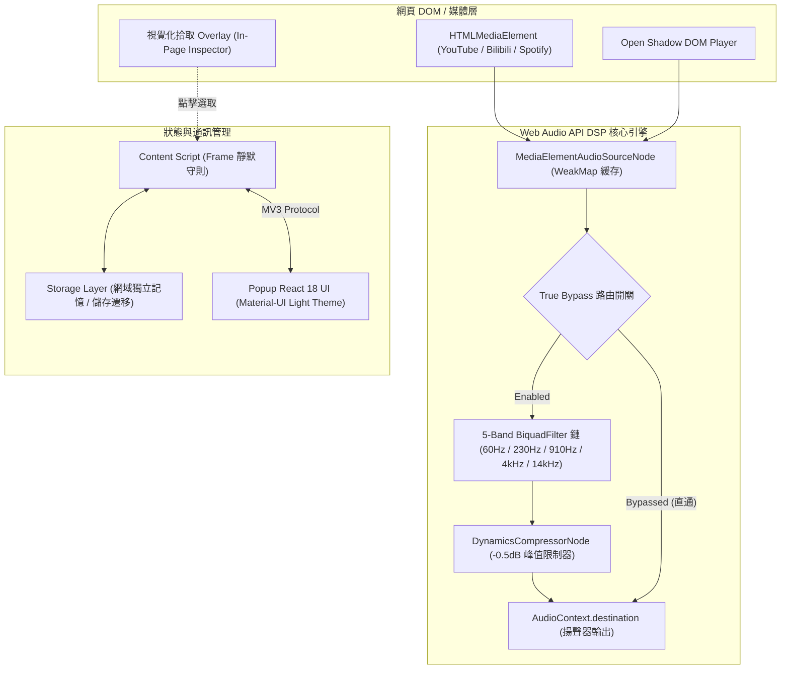

# 現代化網頁音訊等化器設計 (Equalizer)
> **打造無損、低延遲、沉浸式的跨平台瀏覽器音訊增強體驗**

---

## 📌 一句話專案簡介 (Elevator Pitch)
基於 **WXT + React 18 + TypeScript + Web Audio API** 打造的高效能瀏覽器擴充功能。具備 5 頻段專業數位訊號處理（DSP）、防破音動態壓縮限制器、硬體級透明旁路直通，以及全自動多媒體偵測與視覺化畫面元素拾取技術，為使用者在 YouTube、Bilibili、Spotify 等影音平台提供頂級自訂聽覺體驗。

---

## 💼 履歷精華亮點 (Resume Bullet Points)

- **核心音訊工程**：使用 **Web Audio API** 實作 5 頻段雙二次濾波器鏈（BiquadFilter）與動態壓縮峰值限制器（DynamicsCompressor），支援 -12dB ~ +12dB 即時無破音增益調整，並實作 **硬體級透明旁路直通（True Bypass）**，關閉時訊號 0 毫秒延遲直通輸出。
- **多 Frame 通訊架構與防禦**：針對 MV3 跨域 iframe 環境設計 **Frame 靜默守則（Silence Guard）** 與 Popup 雙層狀態鎖定，徹底解決主流影音平台（如 YouTube 廣告、第三方外嵌）並行廣播覆蓋主視訊的競爭條件（Race Condition）難題。
- **智慧媒體辨識與畫面拾取**：深度走訪 DOM 與 **Open Shadow DOM**，針對 YouTube (SPA 換頁無縫重掛)、Bilibili 與 Spotify Web (0x0 背景音訊懸浮膠囊) 進行標題/狀態深度解析；研發 **視覺化畫面元素拾取模式（DOM Overlay Picker）**，以非破壞性事件攔截支援使用者直覺點擊繫結目標。
- **領域持久化與安全性**：設計依網域獨立隔離記憶（Per-Domain Persistence），並落實**「首次開啟新網站預設旁路（Default Bypassed）」**原則，兼顧使用者體驗與網站原生音訊安全性。
- **工程品質與自動化**：以 **Vitest** 撰寫 22 項涵蓋 DSP 數學限制、儲存結構遷移與多 Frame 路由協定的單元測試；產物無縫相容 Chrome MV3 與 Firefox MV3 雙生態。

---

## 📖 作品集完整介紹 (Cake Portfolio Narrative)

### 1. 專案背景與痛點 (Problem Statement)
隨著網頁端串流影音（YouTube、Bilibili、Twitch、Spotify）普及，使用者對音質的要求日益提升。然而，現有瀏覽器原生音訊面臨諸多限制：
- **缺乏微調彈性**：無法針對人聲不清、低音沉悶或耳機頻率響應不均進行個人化補償。
- **增益破音失真**：多數簡單擴充功能在調高特定頻率時直接發生數位削波（Clipping Distortion），音質嚴重受損。
- **多媒體環境混亂**：現代網頁常充斥廣告、彈窗與背景音訊，舊式擴充功能容易繫結錯誤對象，甚至在 YouTube SPA 切換影片時失去連線。

因此，本專案以**「專業音響調音品質」**與**「直覺極簡互動」**為核心目標，由底層重新架構出一個現代化的網頁音訊等化器。

---

### 2. 系統架構圖 (System Architecture)

---

### 3. 技術深度與架構突破 (Technical Deep Dive)

#### 🎵 A. 專業音訊數位訊號處理 (Web Audio DSP)
- **5 頻段雙二次濾波器鏈**：精選 60Hz（重低音）、230Hz（低頻厚度）、910Hz（人聲核心）、4kHz（清晰度與齒音）與 14kHz（超高頻空氣感）等五個黃金頻段，增益範圍嚴格收斂在 -12dB 至 +12dB 之間。
- **透明動態壓縮峰值限制器**：在濾波器後端串接極低延遲的 `DynamicsCompressorNode`（Threshold -0.5dB、Ratio 20:1、Attack 3ms），當使用者調高頻段時，自動撫平尖峰避免數位削波，保障極致通透的聽感。
- **硬體級透明旁路（True Bypass）**：當使用者關閉等化器時，音訊直接從 MediaElementSource 旁路直通輸出至聲卡，完全中斷濾波器運算，達成 0 運算消耗與 0 毫秒額外延遲。

#### 🛡️ B. 多 Frame 競爭防禦與通訊協定
- **問題**：大型影音網站（如 YouTube）內部常包含數個廣告或驗證用子 iframe，在 MV3 `allFrames: true` 下，廣播訊息會被所有 iframe 接收。未持有媒體的子 iframe 掃描後常誤報 `no_media`，在非同步競爭中覆蓋主畫面狀態。
- **解法**：實作**「Frame 靜默守則」**——無媒體之子 iframe 嚴禁主動發送降級廣播；並在 Popup 端實作狀態防禦鎖，杜絕並行干擾。

#### 🎯 C. 智慧探索與視覺化元素拾取模式 (Element Picker Overlay)
- **多維度推薦評分**：依發聲狀態（`!paused && !muted && volume > 0` 權重最高）、畫面像素維度與播放長度評分，自動標示「⭐ 最佳推薦」。
- **DOM 畫面拾取模式**：使用者點擊即可在網頁端開啟全螢幕巡檢，滑鼠懸停於視訊或播放器容器（`.html5-video-player`, `.bpx-player-video-wrap` 等）時即時高亮顯示並提示標題；點擊時攔截原事件（`preventDefault` / `stopPropagation`），在不中斷影片播放的情況下無感切換。
- **Spotify 背景音樂懸浮膠囊**：針對無畫面像素（0x0）的純音訊元素，自動在畫面底部生成浮動膠囊按鈕，讓背景音樂也能一鍵拾取。

#### 💾 D. 依網域隔離記憶與安全預設
- 透過正規化網域名稱持久化使用者的啟用習慣，在不同平台間無縫切換。
- 貫徹**「首次造訪新網域預設 Bypassed」**原則，確保使用者瀏覽新網站時音訊不會被非預期竄改。

---

### 4. 使用者介面與互動設計 (UI/UX Design)
- **頂級淺色現代風格**：擺脫傳統擴充功能簡陋灰暗的介面，以 Material-UI 打造純淨、細緻的 Light Theme。
- **分頁架構整合**：將開關狀態列、全寬預設下拉選單、兩列精準對齊動作按鈕（★ 首選、💾 儲存、➕ 另存、⟲ 還原、🗑 刪除）與垂直滑桿高度模組化整合。
- **0dB 參考刻度與自然多語適配**：垂直滑桿中央附帶細緻 0dB 虛線基準，針對英文字串長度擴展寬度至 400px，杜絕文字折行與版面擠壓。

---

### 5. 專案產出與品質指標 (Results)
- **雙平台封裝支援**：單一程式碼庫透過 WXT 自動建置 Chrome MV3 與 Firefox MV3 發行套件。
- **自動化測試健全度**：撰寫 22 項單元與整合測試，覆蓋率包含濾波器增益數值截斷、WeakMap 記憶體去重、版本資料庫遷移與多 Frame 路由。
- **極致輕量**：打包後壓縮體積僅約 154 KB，啟動載入低於 0.1 秒。
