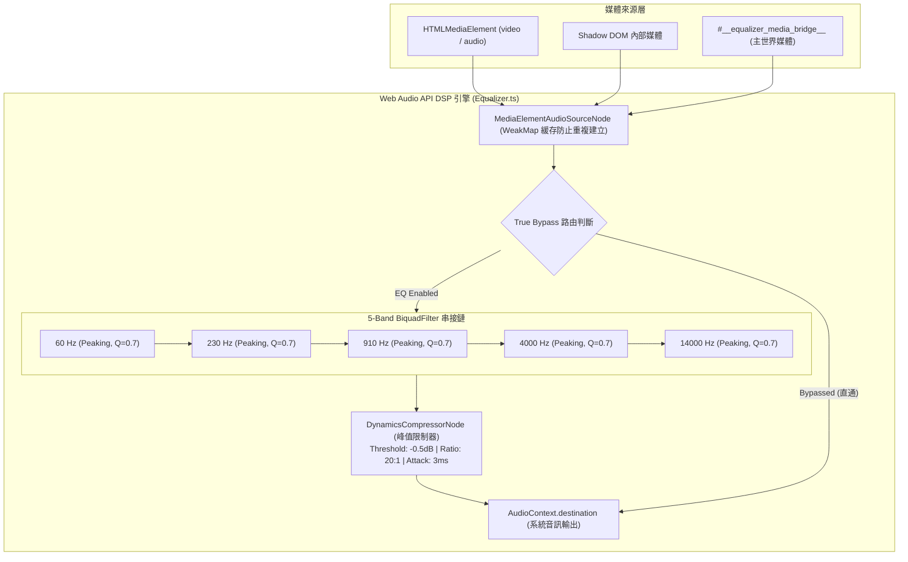
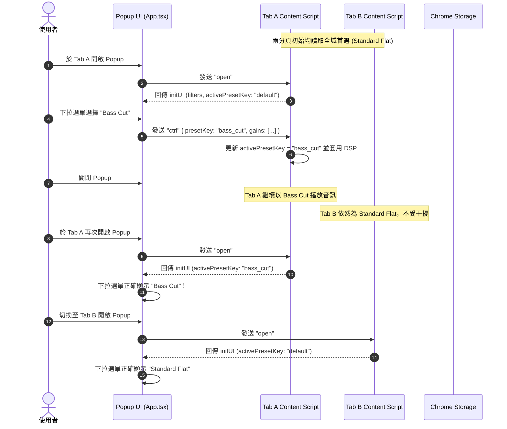

# SoundCraft EQ - 專案全方位架構與產品介紹全書 (Project Master Overview)

> **SoundCraft EQ (專業音訊調音等化器 / Audio Equalizer)**  
> 專為現代影音串流設計的高效能、低延遲、無失真瀏覽器音訊增強擴充功能（支援 Chrome、Edge、Brave 及 Firefox）。

---

## 📑 目錄 (Table of Contents)

1. [專案定位與核心價值 (Project Vision & Identity)](#1-專案定位與核心價值)
2. [完整功能特點 (Feature Highlights)](#2-完整功能特點)
3. [核心音訊架構與 DSP 引擎 (Audio DSP Architecture)](#3-核心音訊架構與-dsp-引擎)
4. [智慧媒體探索與視覺化拾取 (Smart Media Discovery & Overlay Picker)](#4-智慧媒體探索與視覺化拾取)
5. [Spotify 離線音訊攔截與發聲優先權技術 (Spotify & Media Priority)](#5-spotify-離線音訊攔截與發聲優先權技術)
6. [多分頁獨立狀態架構 — 模式甲 (Per-Tab Preset Synchronization)](#6-多分頁獨立狀態架構--模式甲)
7. [多 Frame 通訊防禦協定 (Multi-Frame Silence Guard Protocol)](#7-多-frame-通訊防禦協定)
8. [UI/UX 設計系統與操作互動 (Design System & Controls)](#8-uiux-設計系統與操作互動)
9. [雙平台商店上架與審核資料庫 (Store Listings & AMO Reviewer Pack)](#9-雙平台商店上架與審核資料庫)
10. [測試體系、品質工程與打包建置 (Testing, Quality & Build)](#10-測試體系品質工程與打包建置)
11. [代碼庫結構與模組職責 (Codebase Directory & Module Map)](#11-代碼庫結構與模組職責)

---

## 1. 專案定位與核心價值

### 1.1 一句話專案簡介 (Elevator Pitch)
SoundCraft EQ 是一套基於 **WXT + React 18 + TypeScript + Web Audio API** 的現代瀏覽器擴充功能。具備 5 頻段專業數位訊號處理（DSP）、防破音透明動態壓縮峰值限制器（Peak Limiter）、硬體級 0ms 透明旁路直通（True Bypass）、全自動多媒體辨識、非破壞性視覺化畫面拾取技術，以及多分頁獨立預設記憶架構，為使用者在 YouTube、Bilibili、Spotify、Netflix、Twitch 等平台提供純淨且強大的聽覺體驗。

### 1.2 解決的痛點 (Problems Solved)
| 傳統擴充功能痛點 | SoundCraft EQ 解決方案 |
| :--- | :--- |
| **高頻/低頻調高時數位破音失真 (Clipping Distortion)** | 串接透明動態壓縮限制器（Threshold -0.5dB, Ratio 20:1），在飽和前自動平滑尖峰，無感防破音。 |
| **YouTube SPA 換頁或點擊下一部影片後等化器斷線** | 全域監聽播放生命週期與 `yt-navigate-finish` 事件，實現秒級無縫自動重新掛載。 |
| **Spotify Web 播放器使用 Detached DOM 造成無法偵測** | 注入 MAIN 世界鉤子攔截未掛載至 DOM 的媒體原型，並透過 Bridge 自動橋接至等化器管線。 |
| **背景靜音短影片（如 Spotify Canvas）搶佔音訊節點** | 研發發聲狀態加權演算法，發聲媒體（`audible`）享有 +800 分優先權，徹底過濾無聲影片。 |
| **多 iframe 網站（如 YouTube 廣告、第三方外嵌）狀態覆蓋競爭** | 實作「Frame 靜默守則」與 Popup 狀態防禦鎖，無媒體之子 iframe 嚴禁發布降級覆蓋。 |
| **分頁間預設互相干擾、全域最愛與當前預設耦合** | 採用「模式甲（多分頁完全獨立）」架構，分頁各自記憶當前預設，新分頁自動繼承全域首選。 |
| **關閉等化器時仍佔用 CPU 運算資源** | 實作硬體級 True Bypass，關閉時訊號直接由 Source 直通揚聲器，濾波器停止處理，達到 0 額外耗能與 0ms 延遲。 |

---

## 2. 完整功能特點

- **🎵 5 頻段專業雙二次濾波器鏈**：60Hz（重低音）、230Hz（低頻厚度）、910Hz（人聲核心）、4kHz（清晰度與咬字）、14kHz（超高頻空氣感），支援 -12dB 至 +12dB 即時精準微調。
- **🛡️ 透明防破音峰值限制器 (DynamicsCompressorNode)**：終端內建透明保護，增益推滿也不會爆音。
- **⚡ 硬體級透明旁路直通 (True Bypass)**：一鍵切換電源開關；開啟時套用濾波器，關閉時 0ms 延遲直通輸出。
- **🎯 視覺化畫面元素拾取模式 (In-Page Element Picker Overlay)**：
  - 深入巡檢 DOM 與 Open Shadow DOM。
  - 滑鼠懸停即時顯現藍色虛線框與標題徽章。
  - 非破壞性事件攔截（`preventDefault`, `stopPropagation`），點擊即可繫結，不干擾原生播放。
  - 提供針對 0x0 像素純音訊（如 Spotify）的畫面底部懸浮膠囊。
- **📑 模式甲（Per-Tab Independence）多分頁獨立狀態**：
  - 每個分頁在記憶體中維護各自的活躍預設與微調增益。
  - 分頁 A 選擇「Bass Cut」後，重開 Popup 依然顯示「Bass Cut」。
  - 分頁 B 保持自己的預設（如「Standard Flat」）。
  - 新開分頁 C 自動繼承全域最愛（Favorite）。
- **💾 專業預設管理體系**：
  - 內建 4 大系統預設：Standard Flat（標準平直）、Bass Boost（低音強化）、Bass Cut（低音衰減）、Treble Boost（高音強化）、Vocal Boost（人聲強化）。
  - 自訂預設管理：支援「★ 設為全域首選」、「💾 覆蓋儲存」、「➕ 另存新檔」、「⟲ 還原變更」、「🗑 刪除自訂」。
  - 智慧 Dirty 狀態偵測：滑桿數值與預設定義不符時自動啟用「另存」與「還原」。
- **🌐 依網域獨立開關記憶 (Per-Domain Persistence)**：
  - 自動記錄使用者在特定網站的啟用狀態（如在 YouTube 開啟、在 GitHub 保持關閉）。
  - 安全原則：首次開啟全新網域預設為旁路直通（Bypassed），保護網站原生音訊體驗。
- **🌐 完整雙語系支援**：繁體中文（預設）與英文全介面支援，通過 i18n 標準機制切換。

---

## 3. 核心音訊架構與 DSP 引擎

### 3.1 訊號處理流程 (Audio Signal Pipeline)



### 3.2 關鍵工程技術
1. **WeakMap 音訊來源緩存**：瀏覽器規定同一 `HTMLMediaElement` 只能調用一次 `createMediaElementSource()`，重複調用會拋出 `InvalidStateError`。本專案使用 `WeakMap<HTMLMediaElement, MediaElementAudioSourceNode>` 進行全域緩存，確保切換媒體或重新繫結時絕不報錯，且隨媒體銷毀自動釋放記憶體。
2. **AudioParam 平滑過渡 (`setTargetAtTime`)**：使用者拖曳滑桿時，增益數值不是直接賦值，而是透過 `gain.setTargetAtTime(target, audioCtx.currentTime, 0.01)` 以 10 毫秒時間常數指數漸變，徹底消除傳統調音常見的數位爆音與喀噠雜音（Clicking & Popping）。
3. **Transparent Peak Limiter 參數**：
   - `threshold`: -0.5 dB（僅在即將超過數位上限 0dBFS 時介入）
   - `knee`: 4 dB（柔和轉換曲線）
   - `ratio`: 20:1（硬性限制防爆音）
   - `attack`: 0.003 秒（超高速反應）
   - `release`: 0.05 秒（快速釋放避免抽吸效應）

---

## 4. 智慧媒體探索與視覺化拾取

### 4.1 多層級媒體掃描 (`scanMediaElements`)
- **遞迴 DOM 樹走訪**：遍歷常規 DOM 節點。
- **穿透 Open Shadow DOM**：走訪 `node.shadowRoot`，支援各類 Web Components 播放器。
- **Detached Set 補充**：整合 Prototype Hook 補捉到的未掛載媒體。
- **主世界 Bridge 容器**：掃描 `#__equalizer_media_bridge__` 容器。

### 4.2 視覺化畫面元素拾取模式 (DOM Overlay Picker)
當使用者在媒體選單中點擊「🎯 點擊畫面選取目標 (Pick from page)」時：
1. Popup 關閉，網頁端掛載全螢幕半透明虛線檢視層。
2. 滑鼠移動時，透過命中測試搜尋目標媒體或其播放器容器（如 YouTube 的 `.html5-video-player`、Bilibili 的 `.bpx-player-video-wrap`）。
3. 懸停即時以藍色虛線框高亮（`getBoundingClientRect`），並顯示標籤「🎯 [標題] (點擊繫結)」。
4. 點擊時使用 `e.preventDefault()`, `e.stopPropagation()`, `e.stopImmediatePropagation()`，安全繫結目標而不觸發播放器的暫停或進度條跳轉。
5. 若使用者按下 `ESC` 或點擊退出，立即乾淨銷毀事件監聽與高亮容器。

---

## 5. Spotify 離線音訊攔截與發聲優先權技術

### 5.1 Spotify Web 播放器特點與挑戰
Spotify Web 播放器採用獨立架構：
- 播放音樂時，其真正的音訊 `<video>` 標籤並未掛載於常規 DOM 樹上，或者由閉包動態產生。
- 畫面上播放的 7 秒短影片（Canvas Loop）無聲，卻出現在 DOM 中，導致傳統等化器誤判並繫結到無聲影片，聽不到等化效果。

### 5.2 解決方案架構
1. **主世界腳本注入 (`entrypoints/spotify-hook.content.ts`)**：
   - 宣告 `world: "MAIN"`, `runAt: "document_start"`。
   - 攔截 `HTMLMediaElement.prototype.play`，一旦偵測到 Detached 元素調用播放，立刻將其附加至專屬隱形橋接容器 `#__equalizer_media_bridge__`，並發送 CustomEvent 通知 Content Script。
2. **發聲媒體加權評分演算法 (`scoreMedia` & `shouldSwitchMedia`)**：
   - `isAudible(media)`：判定 `!media.paused && !media.muted && media.volume > 0`。
   - 發聲媒體獲得最高權重（+800 分），即使當前正繫結於 Canvas 靜音影片，一旦發聲媒體開始播放，系統自動切換至發聲媒體。

---

## 6. 多分頁獨立狀態架構 — 模式甲

### 6.1 模式甲（Per-Tab Independence）規格
- **分頁隔離**：每個分頁維持各自的 `activePresetKey` 與增益。
- **首選預設解耦**：全域首選（Favorite）僅用於新開分頁的預設值，切換分頁預設不會更動全域首選。
- **微調 Dirty 狀態**：在某預設上手動微調滑桿時，預設下拉選單保持該預設名稱，但狀態標記為 Dirty，自動解鎖「另存新檔」與「還原變更」。

### 6.2 狀態流轉示意圖



---

## 7. 多 Frame 通訊防禦協定

### 7.1 痛點：多 Frame 降級競爭 (Race Condition)
在 YouTube 等複雜網站中，頁面嵌入多個廣告或跨域子 iframe（如 Google Accounts、Rotate Cookies、Doubleclick）。當 Popup 廣播 `open` 或 `autoSelectBest` 時，所有 Frame 皆會響應。未持有媒體的子 Frame 掃描後常誤報 `no_media`，若延遲回傳，會覆蓋掉主 Frame 已建立的 `connected` 狀態。

### 7.2 雙層防禦機制
1. **Frame 靜默守則 (Silence Guard at Content Script)**：
   - 子 iframe 掃描結果若為 0 媒體，嚴格禁止向 Runtime 發送任何主動狀態更新。
   - 頂層視窗（Top Window）在無媒體時，強制延遲 150ms～200ms 響應，優先禮讓持有媒體的子 Frame 回傳。
2. **Popup 狀態防禦鎖 (State Protection at Popup)**：
   - 當 Popup 當前處於 `connected` 狀態時，若收到來自無媒體來源的 `no_media` 訊息且 `mediaList` 為空，一律予以攔截丟棄，防止介面閃爍或降級。

---

## 8. UI/UX 設計系統與操作互動

### 8.1 視覺風格規範
- **精緻淺色現代主題 (Light Theme)**：選用柔和灰階背景與 Material-UI 深藍（#1976d2）品牌主色，視感專業通透。
- **400px 寬度黃金佈局**：容納繁中與英文字串，垂直滑桿與控制元件無任何折行或擠壓。
- **0dB 參考基準刻度**：五頻段滑桿正中央刻劃精緻 0dB 虛線基準，便於直覺識別正負增益。

### 8.2 按鈕佈局與互動邏輯
介面採用高對齊度雙行 3 欄式按鈕佈局：

```
[ ★ 設為首選 (Favorite) ] [ 💾 覆蓋儲存 (Update) ] [ ➕ 另存新檔 (Save As) ]
[      ⟲ 還原變更 (Revert)      ] [       🗑 刪除預設 (Delete)       ]
```

- **★ 設為首選**：將當前選取的預設標記為全域首選（新分頁與新網站的預設載入檔）。
- **💾 覆蓋儲存**：僅在「自訂預設」且「有微調 (Dirty)」時啟用，覆蓋儲存目前調音數值。
- **➕ 另存新檔**：將目前滑桿數值另存為全新自訂預設名稱。
- **⟲ 還原變更**：當滑桿有微調時啟用，一鍵復原回當前預設的原始數值。
- **🗑 刪除預設**：僅在「自訂預設」時啟用，刪除後自動重設回標準平直（Standard Flat）。

---

## 9. 雙平台商店上架與審核資料庫

本專案已完全通過 **Mozilla Firefox Add-ons (AMO)** 與 **Chrome Web Store** 上架規範：

### 9.1 Firefox AMO 審核專用規格
- **擴充套件名稱**：
  - 英文：`SoundCraft EQ - Audio Equalizer`
  - 繁中：`SoundCraft EQ - 專業音訊調音等化器`
- **套件 ID**：`soundcraft-eq@jay.addons.mozilla.org`
- **最小相容版本**：Firefox 140.0+ (`strict_min_version: "140.0"`)
- **資料收集宣告**：`data_collection_permissions: { required: ["none"] }`（完全無收集任何個人資料）
- **隱私權政策**：專案根目錄附帶完整繁體中文與英文雙語 [`PRIVACY.md`](file:///d:/project/equalizer-extension/PRIVACY.md)。

### 9.2 權限使用正當性說明 (Permissions Justification)
- `storage`：儲存使用者的等化器預設、首選調音檔以及各網域獨立開關偏好，完全儲存於本機。
- `tabs`：獲取當前分頁網域名稱（以實現依網域獨立記憶）並與當前分頁 Content Script 進行安全通訊。
- `host_permissions (<all_urls>)`：等化器需要掛載至使用者開啟的任意音訊網站（如 YouTube、Bilibili、Spotify 等）DOM 中以連接 Web Audio API 節點。

### 9.3 官方商店展示截圖庫 (`release/portfolio_screenshots/`)
全數規格符合 Chrome / AMO 標準 **1280 × 800 (16:10)** 高解析度 PNG：
1. `01_hero_equalizer.png`：主面板外觀、5 頻段滑桿、按鈕矩陣與連線狀態晶片。
2. `02_media_picker_menu.png`：智慧媒體探索選單、播放中狀態與推薦標籤。
3. `03_inpage_picker_overlay.png`：全網頁 DOM 視覺化巡檢拾取模式高亮展示。
4. `04_preset_selector_menu.png`：系統與自訂調音預設集下拉選單。
5. `05_band_guide.png`：五頻段聲學調整教育指引頁籤。

---

## 10. 測試體系、品質工程與打包建置

### 10.1 自動化測試矩陣 (Vitest 5.0.5)
本專案建立 4 大測試模組，共 **28 項自動化單元與整合測試**，全數綠燈通過：

| 測試檔案 | 涵蓋範疇與驗證核心 |
| :--- | :--- |
| `tests/equalizer.test.ts` | 5 頻段 BiquadFilter 建立、增益數值自動截斷（-12dB ~ +12dB）、DynamicsCompressor 峰值限制器參數、True Bypass 訊號切換直通。 |
| `tests/mediaHelper.test.ts` | DOM 媒體維度解析、標題提取、發聲優先權加權（Audible 享有 +800 分優勢，解決 Spotify Canvas 衝突）。 |
| `tests/storage.test.ts` | 舊版 Map 序列化遷移修復、儲存讀寫、依網域獨立記憶與預設旁路規則。 |
| `tests/protocol.test.ts` | 多 Frame 靜默守則、Popup 狀態防禦鎖、多分頁獨立狀態同步（模式甲 Tab A / Tab B / Tab C 隔離驗證）、Dirty 狀態判定。 |

### 10.2 建置與發行指令
```bash
# 依賴安裝
npm install

# 執行型別檢查 (0 Errors)
cmd /c npm run compile

# 執行全單元測試 (28 Passed)
cmd /c npm test

# 雙平台生產打包 (產出雙 Zip 發布檔與審核源碼包)
cmd /c "npm run zip:firefox && npm run zip"
```

產物輸出目錄：
- `.output/equalizer-extension-1.0.0-chrome.zip`（Chrome Web Store 上架包，約 161 KB）
- `.output/equalizer-extension-1.0.0-firefox.zip`（Firefox AMO 簽署發行包，約 161 KB）
- `.output/equalizer-extension-1.0.0-sources.zip`（Firefox AMO 開源審核源碼包）

---

## 11. 代碼庫結構與模組職責

```
equalizer-extension/
├── entrypoints/
│   ├── background.ts                 # 背景服務腳本 (MV3 Service Worker)
│   ├── content.ts                    # 網頁端 Content Script (DOM 掃描、Picker 拾取、訊息路由)
│   ├── spotify-hook.content.ts       # 主世界注入腳本 (MAIN world hook, 橋接 Spotify 離線音訊)
│   └── popup/
│       ├── App.tsx                   # Popup 主容器元件 (分頁狀態管理、通訊監聽、預設同步)
│       ├── Equalizer.tsx             # 等化器面板 (狀態列、媒體選單、預設選擇器、垂直滑桿)
│       ├── Help.tsx                  # 聲學頻段導引與教育說明頁籤
│       ├── index.html                # Popup 容器 HTML
│       └── main.tsx                  # React 18 掛載進入點
├── utils/
│   ├── equalizer.ts                  # Web Audio API 核心類別 (BiquadFilter 鏈、Limiter、Bypass)
│   ├── filterData.ts                 # 系統預設調音集定義 (Flat, Bass Boost, Treble Boost 等)
│   ├── mediaHelper.ts                # 媒體偵測、評分演算法、標題提取、CORS 判定
│   ├── storage.ts                    # 現代化 Storage 封裝 (含架構遷移與網域持久化)
│   ├── tool.ts                       # 通訊工具函式 (sendMessageToCurrentTabs, getDomain)
│   ├── types.ts                      # 全專案 TypeScript 型別定義與通訊協議結構
│   └── version.ts                    # 擴充功能版本宣告
├── tests/                            # Vitest 自動化測試套件
│   ├── equalizer.test.ts
│   ├── mediaHelper.test.ts
│   ├── protocol.test.ts
│   ├── storage.test.ts
│   └── mocks/audio.ts                # Web Audio API Mock (AudioContext, BiquadFilter, Compressor)
├── public/
│   ├── _locales/                     # i18n 語系檔 (zh / en)
│   └── icons/                        # 擴充功能圖示 (32, 64, 128px)
├── release/
│   ├── logo-128.png                  # AMO / Web Store 128x128 專用高解析度 Logo
│   └── portfolio_screenshots/        # 1280x800 商店展示實機截圖 (01~05)
├── CAKE_PORTFOLIO.md                 # 作品集精華版 (Resume & Showcase)
├── PRIVACY.md                        # 隱私權保護政策 (雙語)
├── PROJECT_OVERVIEW.md               # 【本文件】專案全方位架構與介紹全書
├── README.md                         # 開發與安裝快速指南
└── wxt.config.ts                     # WXT (Vite 8) 雙生態建置配置檔
```
