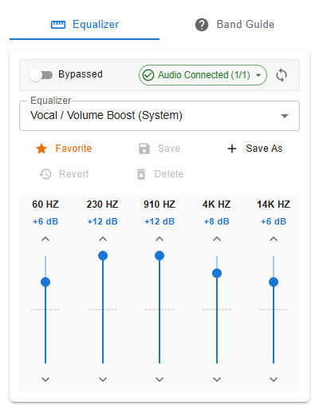
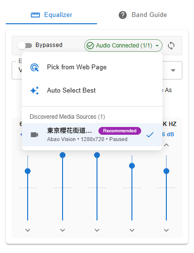
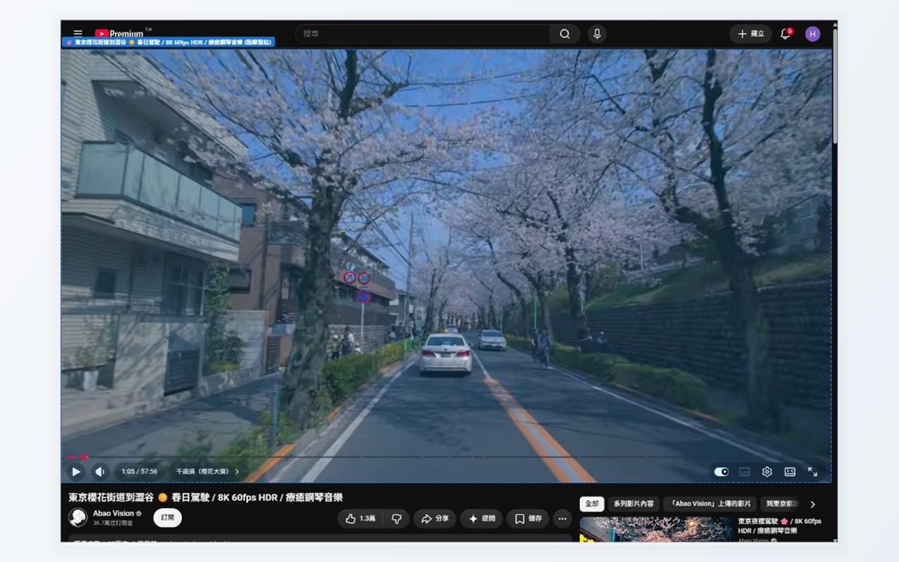
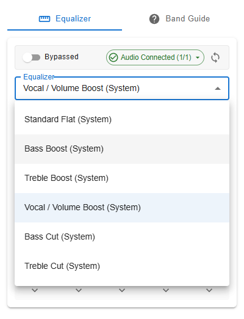
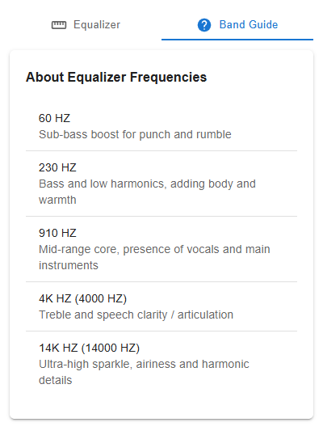

# SoundCraft EQ — 瀏覽器等化器擴充功能


高品質 Web Audio 5 頻段音訊等化器瀏覽器擴充功能。支援 Chrome、Edge、Brave 及 Firefox (MV3)。

## 📥 安裝

- **Chrome / Edge / Brave**：[Chrome Web Store](https://chromewebstore.google.com/detail/soundcraft-eq-audio-equal/nfkljeighcefimkcgmcfbkmojnpggljf)
- **Firefox**：[Firefox Add-ons (AMO)](https://addons.mozilla.org/en-US/firefox/addon/soundcraft-eq-audio-equalizer/)

> 版本異動請見 [CHANGELOG.md](CHANGELOG.md)。

---

## 🖼️ 畫面截圖



<table>
  <tr>
    <td width="50%"></td>
    <td width="50%"></td>
  </tr>
  <tr>
    <td align="center">媒體來源選單：自動選擇或手動指定</td>
    <td align="center">頁面內元素選取器</td>
  </tr>
  <tr>
    <td width="50%"></td>
    <td width="50%"></td>
  </tr>
  <tr>
    <td align="center">內建預設選單</td>
    <td align="center">頻段說明 (Band Guide)</td>
  </tr>
</table>

---

## 🚀 特色功能

- **高品質 5 頻段等化器**：60Hz、230Hz、910Hz、4kHz、14kHz，支援 -12dB 至 +12dB 微調。
- **透明防破音動態壓縮器 (DynamicsCompressorNode)**：終端內建 Peak Limiter，高增益時有效防止數位爆音與破音。
- **真正旁通 (True Bypass)**：關閉時 0ms 延遲、零 CPU 負擔。
- **分頁獨立預設狀態**：每個分頁各自保存目前套用的預設與微調增益，重新開啟 Popup 時會正確還原；新分頁自動套用「最愛」預設，切換預設不會改動全域最愛。
- **依網域記憶開關**：依主機名稱記住啟用 / 停用偏好，首次造訪的網域預設為旁通。
- **全域主動音訊捕獲**：
  - 捕獲階段監聽全頁播放事件 (`play`)，無縫銜接 YouTube 切換影片、Spotify 等 SPA 網站。
  - 遞迴穿透 Open Shadow DOM 與 iFrame (`all_frames: true`)，相容各類客製化 Web 播放器。
  - 智慧優先權判定：自動鎖定發聲播放中的媒體，過濾背景無聲廣告。
  - 頁面內元素選取器：可手動點選要接管的媒體元素。
  - Spotify Web 支援：透過 MAIN world 橋接腳本捕獲脫離 DOM 的播放元素。
- **CORS 跨域限制安全偵測**：即時識別受 CORS 標頭限制之媒體，並於 Popup 狀態晶片友善提示。
- **多語系支援**：英文 (`en`，預設)、繁體中文 (`zh_TW`)、簡體中文 (`zh_CN`)。
- **現代化儲存與遷移**：修復舊版 `Map` 序列化遺失缺陷，升級版本時完整保留使用者的自訂預設。

---

## 🛠️ 開發與建置

本專案使用 [WXT](https://wxt.dev/)（基於 Vite 8）與 React 18 + MUI 進行建置。

### 安裝依賴
```bash
npm install
```

### 開發模式 (含熱重載 HMR)
```bash
npm run dev           # Chrome
npm run dev:firefox   # Firefox
```

### 生產建置
```bash
npm run build         # 建置 Chrome MV3 (.output/chrome-mv3)
npm run build:firefox # 建置 Firefox MV3 (.output/firefox-mv3)
```

### 型別檢查
```bash
npm run compile
```

### 測試 (Vitest)
```bash
npm test
```

### 打包發布檔 (Zip)
```bash
npm run zip           # 產出 Chrome Web Store zip (.output/equalizer-extension-1.1.0-chrome.zip)
npm run zip:firefox   # 產出 Firefox AMO zip 與審核源碼包
```

---

## 📦 如何在瀏覽器中載入測試

### Google Chrome / Edge / Brave:
1. 開啟瀏覽器並前往 `chrome://extensions/`（Edge 則為 `edge://extensions/`）。
2. 在右上角開啟「**開發人員模式** (Developer mode)」。
3. 點選「**載入未封裝項目** (Load unpacked)」。
4. 選擇專案資料夾下的 `.output/chrome-mv3` 目錄。

### Mozilla Firefox:
1. 開啟 Firefox 並前往 `about:debugging#/runtime/this-firefox`。
2. 點選「**載入暫時性附加元件** (Load Temporary Add-on)」。
3. 選擇專案資料夾下的 `.output/firefox-mv3/manifest.json`。

---

## 📚 相關文件

- [CHANGELOG.md](CHANGELOG.md)：版本更新紀錄
- [PROJECT_OVERVIEW.md](PROJECT_OVERVIEW.md)：專案架構總覽
- [STORE_LISTING.md](STORE_LISTING.md)：商店上架文案與審核說明
- [PRIVACY.md](PRIVACY.md)：隱私權政策
